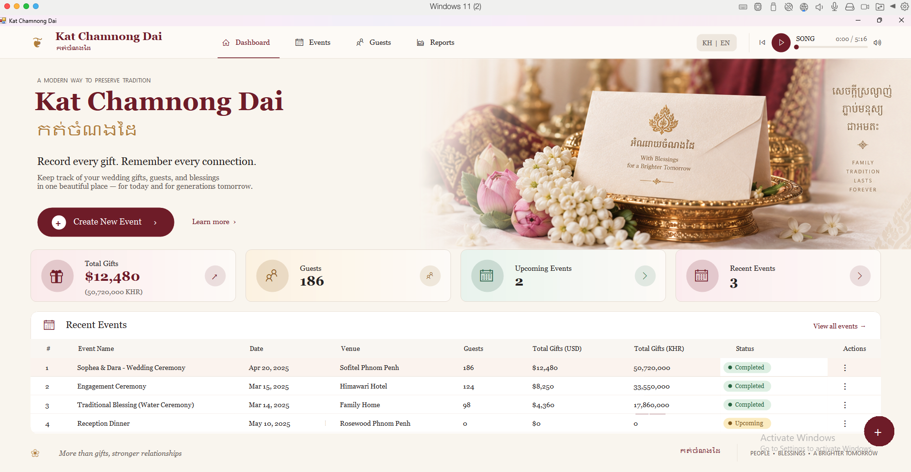
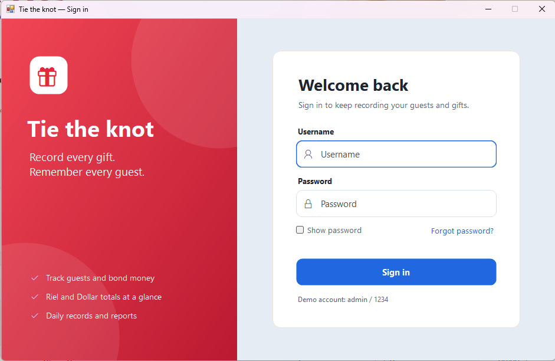
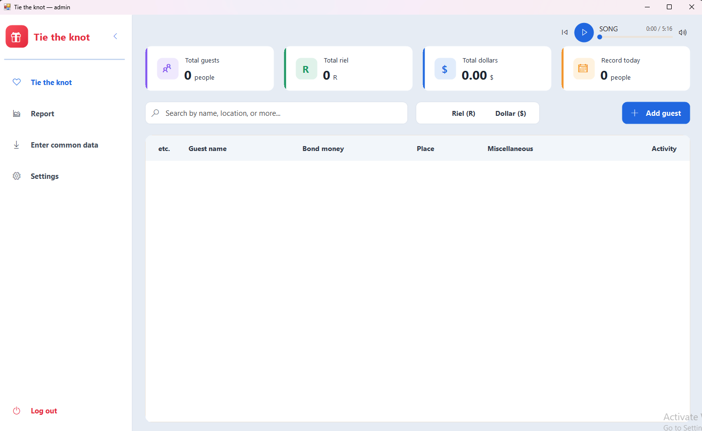

# Kat Chamnong Dai · កត់ចំណងដៃ

A Windows Forms desktop app for recording wedding gifts (*chamnong dai*) and guests, with Riel and Dollar totals, built on .NET Framework 4.7.2 with no third-party packages.



## Screens

### Dashboard
The landing page has an event overview, gift and guest totals, recent events, a monthly events calendar, a background music player and an English / Khmer language switch.

### Sign in



Click **Create New Event** or the **+** button on the dashboard to sign in.

> Demo account: `admin` / `1234`

### Tie the knot: guest book



After signing in, you record each guest's bond money in Riel or Dollars.

- Totals for guests, Riel, Dollars and today's records, with count-up animation
- Search by name, place or notes, and filter by currency
- Add and delete guests
- **Settings → Export to Excel / Import from Excel** (`.xlsx`)
- Collapsible sidebar; **Log out** returns to the dashboard

## Getting started

**Requirements:** Windows 10 or 11 and Visual Studio 2019 or later with the *.NET desktop development* workload.

1. Clone the repository.
2. Open `WindowsFormsApp1.sln`.
3. Press **F5**.

Images and the song are copied to the output folder on build.

## Project structure

```
WindowsFormsApp1/
├── Program.cs         Entry point: opens the dashboard
├── Form1.cs           Dashboard, calendar page, KH/EN language switch
├── LoginForm.cs       Sign-in screen and shared input/button controls
├── MainForm.cs        Guest book, settings page, add-guest dialog, animations
├── MusicPlayer.cs     Play/pause, seek and mute controller (Windows MCI)
├── Xlsx.cs            Minimal .xlsx reader/writer (zip + XML, no dependencies)
├── Images/hero.png    Dashboard banner
├── Song/song.mp3      Background music
└── Screenshort/       README screenshots
```

## Notes

- **Data is kept in memory only.** Guests are cleared when the app closes, so use **Export to Excel** to keep a copy.
- **The login uses demo credentials** hard-coded in `LoginForm.cs`. Replace them with real accounts before production use.
- **The dashboard figures are sample data.**
- **Excel import** matches columns by header name. Only `Guest name` and `Bond money` are required, and exporting once gives you a ready-made template.
